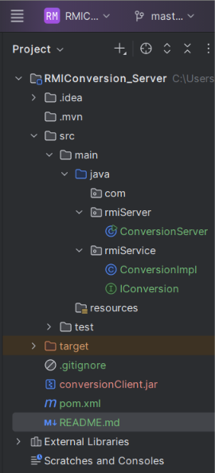
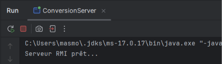

# RMIConversion_Server

Projet **serveur** du TP5 – Activité 5-1 (Développement d'Applications Réparties).
Il expose un service distant de conversion de devise (euro → dinar tunisien) avec Java RMI et JNDI.

## Rôle
- Définir l'interface distante `IConversion` (le contrat partagé avec le client).
- Implémenter le service (`ConversionImpl`) : `convertirMontant(mt)` renvoie `mt * 3.43`.
- Démarrer le registre RMI (port 1099) et publier l'objet sous le nom `converBank` via JNDI.

## Structure





## Fichier jndi.properties
```
java.naming.factory.initial = com.sun.jndi.rmi.registry.RegistryContextFactory
java.naming.provider.url = rmi://localhost:1099
```

## Génération du JAR API pour le client
Le client ne doit recevoir que l'interface. Après compilation :
```
jar cf conversionClient.jar -C target/classes rmiService/IConversion.class
```
Le jar ne contient que `IConversion.class`.

## Exécution
1. Compiler le projet (IntelliJ : Build → Build Project, ou `mvn clean compile`).
2. Lancer `rmiServer.ConversionServer`.
3. Attendre le message : `Serveur RMI + JNDI prêt...`
4. Laisser le serveur actif, puis lancer le client (projet `RMIConversion_Client`).




À chaque appel reçu : `Requête reçue : conversion de <montant> EUR en DT`.


## Synthèse

Dans cette activité, nous avons développé une application répartie avec **Java RMI**, qui permet à un client d'appeler une méthode située sur un objet d'une autre JVM comme s'il s'agissait d'un objet local. Contrairement aux sockets, le programmeur n'écrit ni protocole, ni gestion de flux : RMI prend en charge la communication (marshalling / unmarshalling) et seul le traitement métier reste à coder.

**Côté serveur**, nous avons défini :
- l'interface distante `IConversion`, qui étend `Remote` et dont chaque méthode déclare `RemoteException` (le réseau peut échouer) ;
- la classe `ConversionImpl`, qui étend `UnicastRemoteObject` : elle contient le vrai code de `convertirMontant` et est exportée automatiquement (port TCP ouvert, stub généré dynamiquement) ;
- la classe `ConversionServer`, qui démarre le registre RMI (`LocateRegistry.createRegistry(1099)`), crée l'objet distant et le publie sous le nom symbolique `converBank` grâce à JNDI (`InitialContext.rebind`), configuré par `jndi.properties`.
  **Côté client**, le projet est indépendant du serveur. Il ne possède que l'interface `IConversion`, fournie par le JAR API `conversionClient.jar` : le client ne connaît jamais l'implémentation. Il se connecte à l'annuaire via JNDI (`InitialContext.lookup("converBank")`), obtient un **stub** (représentant local de l'objet distant) et appelle `convertirMontant(500)`, qui renvoie 1715.0 (500 × 3.43).

**Trois échanges réseau** ont lieu : (1) le serveur publie l'objet dans le registre (`rebind`), (2) le client le recherche (`lookup`), (3) le client invoque la méthode, que le stub transmet par TCP à l'objet distant, et le résultat revient en sens inverse.

**Intérêt de l'architecture :** séparation claire entre le contrat (l'interface) et l'implémentation, transparence de l'appel distant, et possibilité de modifier l'implémentation du serveur sans toucher au client tant que la signature ne change pas. **Limite :** RMI est réservé aux applications 100 % Java ; pour des clients dans d'autres langages, on préférera CORBA, SOAP ou REST.